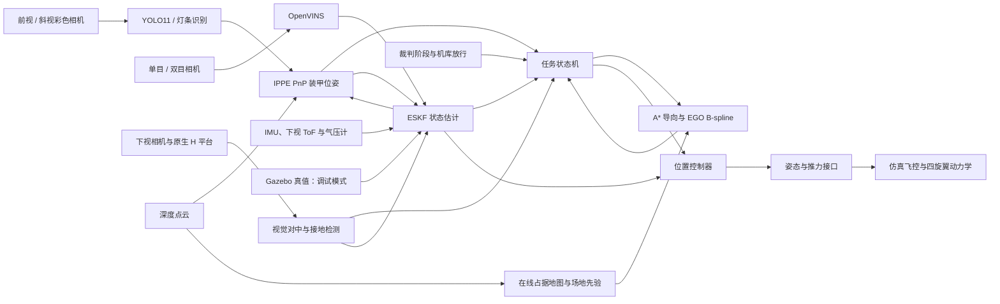

# RM27 DRONE

这是一个 RoboMaster 2027 无人机仿真项目，用 ROS 2 Humble、Gazebo Classic 11 和 C++ 实现。

目前主要跑单机流程：从机库起飞，飞到敌方基地或前哨站，识别装甲并接触目标，然后撤离、返航，在机库上方视觉对中、降落停桨。默认在比赛时间内重复接近目标，也可以只跑一次。

代码在本地修改，编译和运行放到 Ubuntu 虚拟机。下面的命令都在 Ubuntu 中、项目根目录下执行。

[怎么运行](#怎么运行) · [代码怎么分](#代码怎么分) · [运行模式和参数](#运行模式和参数) · [运行时看什么](#运行时看什么) · [仿真预览](#仿真预览) · [来源和许可](#来源和许可)

## 怎么运行

运行环境是 Ubuntu 22.04（也可用 WSL2）、ROS 2 Humble、Gazebo Classic 11 和 OpenVINO C++ Runtime。YOLO 目前用 OpenVINO 在 CPU 上推理。

### 1. 准备依赖

先装好 ROS 2 Humble，再补这些依赖：

```bash
sudo apt install \
  ros-humble-gazebo-ros-pkgs ros-humble-xacro \
  ros-humble-robot-state-publisher ros-humble-rviz2 \
  ros-humble-rqt-image-view ros-humble-image-transport-plugins \
  ros-humble-cv-bridge ros-humble-message-filters \
  ros-humble-tf2-geometry-msgs python3-colcon-common-extensions \
  python3-numpy python3-pil libopencv-dev libeigen3-dev libyaml-cpp-dev \
  libceres-dev libboost-all-dev xvfb mesa-utils
```

安装 [OpenVINO C++ Runtime](https://docs.openvino.ai/2026/get-started/install-openvino.html) 并加载其环境；已有安装时使用对应的 `setupvars.sh`。CMake 需要能找到 `OpenVINOConfig.cmake`，配置方法见[视觉接入文档](docs/vision.md#依赖与构建)。

### 2. 初始化并编译

在项目根目录执行。编译成功后再加载环境：

```bash
git submodule update --init --recursive
./build.sh --cmake-args -DCMAKE_BUILD_TYPE=Release --packages-skip ov_eval ov_data &&
source ws/install/setup.bash
```

`build.sh` 会检查并应用 OpenVINS 静止启动补丁，再编译工作空间。`ov_eval`、`ov_data` 是评测工具和示例数据，运行仿真可以跳过。场地和 YOLO 模型已经在仓库里，不用每次重新生成。

### 3. 启动查看

```bash
./sim.sh mission_mode:=single auto_start:=false
```

这条命令会打开 Gazebo、RViz 和识别窗口，飞机保持停桨。确认场景和图像正常后，再跑任务。直接运行 `./sim.sh` 会进入自动比赛流程。

默认用双目 OpenVINS + ESKF 定位、YOLO 识别和 EGO 在线规划。场地用 2027 V1.0.0 STEP，直接启动就会加载。地图和渲染细节在后面说明。

按需要选一条运行：

```bash
./sim.sh                          # 双目VIO + YOLO + EGO，自动比赛流程
./sim.sh mission_mode:=single      # 单次接触后返航，适合闭环验收
./sim.sh gt mission_mode:=single   # 显式真值调试
./sim.sh mono allow_blind_attack:=false   # 单目 VIO，冲击前要求视觉确认
./sim.sh stereo allow_blind_attack:=false # 双目 VIO，冲击前要求视觉确认
```

EGO 按采样时间把深度点云融合到地图，遇到新障碍会重新规划。深度断流、轨迹过期或近距障碍会触发刹停。任务节点统一发布控制设定点，EGO 把轨迹交给它。场地 CAD 可以作为静态先验，详细说明见[导航文档](docs/navigation.md)。

比赛模式先模拟准备、自检和 5 秒倒计时，再进入 420 秒比赛。准备和自检默认缩短为 3 秒、1 秒；`match_timing:=official` 改为 180 秒、15 秒。定位、深度和机库条件满足后才能起飞。比赛中重复识别、接近和撤离，默认预留最后 60 秒返航。连续三次接近没有确认接触、目标击毁、比赛停止或触发健康保护，也会提前返航或降落。`max_attacks:=3` 表示确认三次接触后返航，`mission_mode:=single` 只跑一次。

默认要有有效视觉观测才能接近装甲。只有设置 `allow_blind_attack:=true`，才允许按地图先验盲接近。自动目标从已知地图中的敌方基地装甲选取，EGO 负责规划航迹。接触次数和裁判得分分开计算，具体条件见[测试记录](docs/sim-acceptance.md)。

## 代码怎么分

先从 `sim.sh` 看起，它调用 `ws/src/rm_drone_bringup/launch/sim.launch.py`，后者负责加载场地、参数和各个节点。

主要数据流：

```text
相机 + IMU → OpenVINS → ESKF → /drone/odom
彩色相机 → YOLO / 灯条识别 → PnP → /drone/armors
深度点云 + 里程计 → 在线地图 + EGO → 局部轨迹
任务状态机读取定位、识别、轨迹和裁判状态 → /drone/setpoint
位置控制器 → 姿态和推力 → 仿真飞控 → 电机 → Gazebo 动力学
下视相机识别 H 平台 → 降落对中，同时给估计器提供校正
```

想改任务流程，看 `rm_drone_planner/src/mission_node.cpp`；想改识别，看 `rm_drone_vision`；想调位置环和仿真内环，看 `rm_drone_control`。下面这些包都在 `ws/src/` 下。

| 功能包 | 职责 |
|---|---|
| `rm_drone_msgs` | 装甲、轨迹、姿态设定、裁判和任务消息 |
| `rm_drone_vision` | YOLO11 / 灯条识别、PnP、视觉调试图像 |
| `rm_drone_estimator` | ESKF、OpenVINS 标定与运行配置 |
| `rm_drone_planner` | 全局导向、轨迹校验、任务状态机和模拟裁判 |
| `rm_ego_planner` | EGO 优化核心、在线深度占据融合、局部重规划和健康检查 |
| `rm_drone_control` | 位置控制、仿真飞控及可选 PX4 桥 |
| `rm_drone_description` | 无人机模型与传感器定义 |
| `rm_field_gazebo` | 场地模型、材质、世界和规划地图生成器 |
| `rm_drone_gazebo_plugins` | 动力学、装甲冲击与场地机构插件 |
| `rm_drone_bringup` | 系统启动与 RViz 配置 |
| `open_vins` | 上游 VIO 子模块，固定版本见[来源说明](docs/credits.md) |

| ROS 接口 | 内容 |
|---|---|
| `/drone/color/image_raw`、`/drone/attack/image_raw` | 前视彩色与基地斜视识别图像，各配套 camera_info |
| `/drone/armors` | 装甲类别、关键点、相机位姿及有效时的 map 位姿 |
| `/drone/odom` | 估计器输出 |
| `/drone/vision/debug_image` | 检测框、关键点、PnP 结果和推理耗时 |
| `/drone/ego/status`、`/drone/ego/occupancy` | 在线地图健康、阻塞状态与观测障碍 |
| `/drone/mission_state` | 任务阶段与状态 |
| `/drone/setpoint`、`/drone/attitude_target` | 轨迹和姿态控制接口 |

### 详细数据关系



`map` 使用 ENU，原点位于场地中心，+x 指向蓝方。视觉输入是彩色相机，VIO 使用独立的单目/双目灰度流。

## 运行模式和参数

| 用法 | 定位来源 | 适用场景 |
|---|---|---|
| `./sim.sh` | 双目 OpenVINS + ESKF | 默认自动比赛流程 |
| `./sim.sh gt` | 仿真真值，关闭 VIO | 显式控制、轨迹与场景调试 |
| `./sim.sh mono` | 单目 OpenVINS + ESKF | 单目视觉惯性定位验收 |
| `./sim.sh stereo` | 双目 OpenVINS + ESKF | 双目视觉惯性定位验收 |
| `./sim.sh off` | ESKF，不启 VIO、不用真值 | IMU / ToF 与估计器调试 |

`mono`、`stereo` 只切换定位方式，识别方式由 `detector` 单独控制。视觉模式要求 VIO 健康，参数和定位模式冲突时会报错，不会自动换成真值。

| 参数 | 用途 | 默认 |
|---|---|---|
| `team:=red/blue` | 本方队伍、机库起点与敌方颜色 | `red` |
| `mission_mode:=match/single` | 比赛时间内重复执行 / 单次接触验收 | `match` |
| `match_timing:=fast/official` | 压缩准备、自检 / 完整规则计时；均保留5秒倒计时 | `fast` |
| `match_duration:=420 return_reserve:=60` | 比赛时长与提前返航预留，单位秒 | `420 / 60` |
| `max_attacks:=auto` | `auto`随任务模式；0按时间持续执行，正数为接触配额 | `auto` |
| `auto_referee:=auto` | 自动模拟比赛阶段，`single`模式默认立即放行 | `auto` |
| `planner:=ego/astar` | EGO 在线局部规划 / 原静态 A* + minimum-snap 对照 | `ego` |
| `map_prior:=true/false` | 是否使用巡航区域 CAD 先验；关闭后未知区域限制、机库起飞配置和规则边界仍保留 | `true` |
| `depth_rate:=auto` | 深度采样率，EGO 20 Hz、静态 A* 5 Hz，可显式设为 1–30 Hz | `auto` |
| `depth_topic:=/drone/depth/points` | 在线建图点云输入话题 | `/drone/depth/points` |
| `target:=auto` | 自动选择，或指定如 `blue_outpost_armor_0` | `auto` |
| `field:=official` | 2027 V1.0.0 STEP 场地，唯一地图，无需手动指定 | `official` |
| `detector:=yolo/traditional` | OpenVINO YOLO11 四关键点 / 传统灯条识别 | `yolo` |
| `render_backend:=auto/native/software` | 自动检测硬件 OpenGL / 桌面渲染 / Xvfb 软件渲染 | `auto` |
| `gui_render_backend:=auto/native/software` | Gazebo 窗口渲染，`auto` 跟随相机后端；可单独切换软件兼容模式 | `auto` |
| `show_features:=true/false` | 预览绿色 FAST 角点，与 YOLO 关键点和 VIO 跟踪无关 | `true` |
| `show_yolo_rejected:=true/false` | 无有效候选时，显示最高分被拒绝的真实网络预测（橙色虚线，仅预览） | `true` |
| `show_yolo_bbox:=true/false` | 额外显示YOLO外接矩形；默认只保留四点轮廓 | `false` |
| `use_depth:=true/false` | 深度图和点云数据源开关；不影响下视 ToF | `true` |
| `auto_start:=false` | 等待手动任务启动 | `true` |
| `lockstep:=auto/true/false` | 相机与物理锁步；`auto` 在视觉定位时锁步，GT时异步 | `auto` |
| `allow_blind_attack:=false` | 冲击前必须获得视觉确认 | `false` |
| `gui:=false rviz:=false imshow:=false` | 关闭图形界面 | 均为 `true` |

## 运行时看什么

### 只跑后台，不开窗口

```bash
./sim.sh gui:=false rviz:=false imshow:=false auto_start:=false
```

### 手动启动或急停

另开一个终端，先执行 `source ws/install/setup.bash`，再按需要执行下面其中一条：

```bash
ros2 topic pub --once /drone/mission/start std_msgs/msg/Empty '{}'
ros2 topic pub --once /drone/estop std_msgs/msg/Bool '{data: true}'
```

### 飞机一直不动

先看终端的“等待起飞”提示，也可以看 `/drone/mission_state` 的 `info` 字段。起飞需要裁判飞行许可、机库放行、定位初始化和新鲜里程计。用 EGO 时，还要有新鲜深度、点云采样时刻的 TF，以及安全的起飞区域。

条件满足后还会等待配置的仿真时间。提示每 5 秒墙钟时间打印一次，虚拟机运行慢时，要同时看提示里的仿真时间。正常状态顺序是 `IDLE → ARMING → TAKEOFF`。如果设了 `auto_start:=false`，还要手动发启动消息。`auto_start` 只接受 `true/false`。

起飞轨迹跑完后，飞机要接近悬停点，位置误差小于 5 cm、速度小于 0.05 m/s，并离开膨胀障碍区，才开始巡航规划。

### 定位模式和仿真时间

GT 模式下开 YOLO 也不会改变定位来源。视觉定位默认让相机和物理锁步，GT 默认异步。禁止盲接近不会改变这个调度方式。仿真暂停或等待渲染时，不把墙钟等待直接累计为数据断流；恢复后仍检查采样时间。实机接收看门狗使用单调时钟。

### 识别画面怎么看

两种识别后端都用 IPPE PnP，`/drone/armors` 中的 `pose_camera` 表示装甲在相机系的位置，`has_map_pose=true` 时才有可用于导航的 `pose_map`。imshow 显示 `yolo/OpenVINO`、推理帧号、耗时、关键点和相机输入帧率。旧帧仍运行推理并显示橙色 `PREVIEW ONLY`，不将旧帧用于定位。查看实时 YOLO 画面可执行 `./sim.sh detector:=yolo auto_start:=false`，各字段与排查方法见[视觉文档](docs/vision.md)。

绿色圆点是 FAST 预览角点，和 YOLO 关键点、VIO 跟踪分开。有效 YOLO 检测显示蓝色实线框和黄色四关键点，PnP 通过后再叠加绿色四边形。橙色虚线 `PREVIEW ... rejected` 表示网络预测被过滤，不进入定位；没有预测时不会画框。

### Gazebo 黑屏或渲染慢

`gzserver` 负责仿真，`gzclient` 负责场景窗口。服务端启动了，窗口仍可能没显示出来。黑屏时可以单独切换窗口的软件渲染：

```bash
./sim.sh gui_render_backend:=software auto_start:=false
```

相机渲染由 `render_backend` 控制，窗口渲染由 `gui_render_backend` 控制。自动模式会检测硬件 OpenGL，没有可用硬件渲染时用 Xvfb 软件渲染。虚拟机渲染慢会拖慢仿真时间。

EGO 默认使用 20 Hz 深度点云，`planner:=astar` 切到静态 A* + minimum-snap 作对照，默认深度为 5 Hz。左右目、彩色、深度图和点云默认保留，RViz 直接显示这些深度数据；下视 ToF 始终保留。

## 目前做到哪了

场地用的是 RMUC 2027 V1.0.0 STEP，保留完整 CAD 场景和原生装甲，补了十二块标准装甲的贴纸、灯条和接触面。基地护甲保持 CAD 中的闭合姿态，机库台面高 1.6 m。世界、出生点、测高、规划地图和装甲坐标使用同一版本资源。旧地图已停用，能量机关、前哨站和飞镖靶保持静止，旧地图的道具运动接口不在这里启用。生成方法见[场地文档](docs/simulation.md#新赛季-step-地图)。

规则参考项目整理时使用的两份 2027 V1.0.0 PDF。无人机接触目标是敌方基地和前哨站普通装甲，飞镖移动靶、能量机关和机库不属于冲击目标。碰撞体、规划体素和仿真参数做过简化，后面上实机还要重新测量、验证。

当前做的是单机仿真，没有完成四机协作、全场战术决策、侦察回传、实机机库通信和充换电、正式裁判协议，也没有实机飞行验证。默认使用仿真飞控，内环读取真值姿态，尚未接入完整 PX4 SITL；仓库里的 PX4 桥是另一个可选接口。

仓库已有单次任务、重复接近和深度断流等[测试记录](docs/sim-acceptance.md)，这些记录有各自的版本和运行条件，换到虚拟机后还需要重新跑。接触任务完成也不代表满足裁判得分条件。检查视觉任务时要关闭盲接近。

默认仿真模型在独立装甲实例上测试过：0.7 阈值下精确率约 98.8%、召回率约 79.1%；INT8 推理中位耗时约 17.5 ms，测试机器是 i9-14900HX、2 线程。板端速度和实机识别效果还没测。

后面上实机，需要替换相机、IMU、ToF 驱动，用 Kalibr 标定外参，测机载推理性能，再配置 PX4、uXRCE-DDS 和 `px4_msgs`。`sim.sh` 只负责仿真。

## 仿真预览

下面是 Gazebo 场地和运行截图。运行截图用的是 GT 真值定位，图片来源见[图片说明](docs/images/README.md)。

**新赛季场地全景**


保留 CAD 场地布局与原生装甲，补充标准小装甲贴纸、红蓝灯条和接触面。能量机关与前哨站保持静止。

**自主规划与飞行可视化**


这张图拍于 2026-10-22，用的是旧版静态规划，现在默认用 EGO 在线规划。棕色方块是 `Field` 规划障碍物，彩色点是深度相机点云；它们是不同的数据来源。`Odom` 仅显示最新姿态，飞行路径单独显示。

**机载相机与视觉推理预览**


这张图用的是旧权重，当前模型的结果在后面。绿色点为 FAST 预览角点。图中 `candidates=0`、`poses=0` 表示该帧没有有效装甲检测；`PREVIEW ONLY` 表示结果仅供查看，不进入视觉导航。当前模型的验证条件与结果见[视觉文档](docs/vision.md)。

| 红方基地标准小装甲 | 蓝方前哨站标准小装甲 |
|---|---|
|  |  |

**当前 INT8 模型的实际预测（独立验证视角）**

| 红方基地 | 蓝方前哨站 |
|---|---|
|  |  |

## 详细文档

- [在线建图、EGO 局部规划与保护逻辑](docs/navigation.md)
- [视觉推理、模型类别与配置](docs/vision.md)
- [地图格式、配色、场地生成与道具调试](docs/simulation.md)
- [第三方模型、算法引用与许可证](docs/credits.md)

除 `rm_ego_planner`（链接上游 EGO 算法，按 GPL-3.0 分发）外，本仓库新增的系统集成与其他 `rm_*` 实现使用 [MIT](LICENSE)；上述第三方代码、模型、权重与纹理的版权及许可单独保留，根目录 MIT 不替代其原有声明。

## 来源和许可

项目用到的代码、模型和权重来源如下，详细记录见[来源说明](docs/credits.md)。

| 来源与作者 | 本项目使用的内容 | 引用方式与许可说明 |
|---|---|---|
| 项目使用的 RMUC 2027 V1.0.0 STEP 场地与能量单元 | 新赛季完整场地几何、面颜色、原生装甲外壳和道具 | 保留原作者权利；原始文件未提供下载链接或独立许可，不按项目 MIT 重许可。见[CAD 来源与转换](ws/src/rm_field_gazebo/models/rmuc2027_official/SOURCE.md) |
| [EGO-Planner / EGO-Swarm — ZJU-FAST-Lab](https://github.com/ZJU-FAST-Lab/ego-planner-swarm)，Xin Zhou、Jiangchao Zhu、Hongyu Zhou、Chao Xu、Fei Gao 及贡献者 | ROS 2 分支的 B-spline 优化核心、局部搜索与多项式初始化；本项目新增在线点云映射和任务适配 | 固定提交 `23a8d5a191711dd65633df689bd00f55d4dea8f9`；GPL-3.0，保留原始声明和[集成来源说明](ws/src/rm_ego_planner/SOURCE.md) |
| [OpenVINS — rpng/open_vins](https://github.com/rpng/open_vins)，Patrick Geneva、Guoquan Huang、Kevin Eckenhoff 及贡献者 | 单目/双目视觉惯性里程计 | 直接包含为 `ws/src/open_vins` 子模块，固定提交 `69488123ed9362dd44b6f28e7f4680abbff1442b`；GPL-3.0-or-later |
| [Daedalus — bevy_robomaster_simulator](https://github.com/Blackjack200/bevy_robomaster_simulator)，Blackjack200 / Actor&Thinker | 旧图曾使用的能量机关 `POWER.glb`、科技核心与机械臂 `TECH_CORE.glb` | 导入并转换为场景网格，固定提交 `43681255bc5415cdc15797d54fe7478062af42ed`；保留原模型、AGPL-3.0 许可及[转换说明](ws/src/rm_field_gazebo/models/rm_field/meshes/source/README.md) |
| RMUC 2026 场地网格，模型元数据署名 **pb2025 / ITL_Hero_Shoot**；相关项目：[北极熊 rmu_gazebo_simulator](https://github.com/SMBU-PolarBear-Robotics-Team/rmu_gazebo_simulator)、[ITL_Hero_Shoot](https://github.com/qwq9966qwq/ITL_Hero_Shoot) | 旧图使用过的场地外观原网格及配色衍生网格；当前场地改用 STEP | 原网格保存在 `ws/src/rm_field_gazebo/models/rmuc_2026`；沿用模型上游许可。北极熊工程的 Apache-2.0 声明与具体模型的授权范围分别记录，见[详细来源](docs/credits.md) |
| [RM27 本地来源工程](https://github.com/abing-coder/RM27)，所用视觉代码保留 **TongjiSuperPower** 版权；对应视觉框架参考 [sp_vision_25](https://github.com/TongjiSuperPower/sp_vision_25) | `yolo11.xml/.bin` 权重副本、YOLO11 预处理/输出解码约定及装甲类别表 | 权重从本地 RM27 工程复制，ROS 2 推理封装在本项目中实现；保留其代码 MIT 许可、版权声明和[文件哈希](ws/src/rm_drone_vision/models/SOURCE.md)。权重的原始训练来源与独立授权尚未核实，不将其归为本项目训练成果 |

默认仿真权重基于 [Ultralytics YOLO11n-pose](https://github.com/ultralytics/ultralytics/tree/v8.3.0) 微调，按 **AGPL-3.0** 提供，使用 [NNCF](https://github.com/openvinotoolkit/nncf) 量化；[训练来源、配方、哈希及许可](ws/src/rm_drone_vision/models/sim_armor/SOURCE.md)均随附。OpenVINS 静止启动修复通过[项目补丁](patches/README.md)提供，`build.sh` 自动检查并应用。

系统还依赖 [ROS 2](https://github.com/ros2/ros2)、[Gazebo Classic](https://github.com/gazebosim/gazebo-classic)、[OpenCV](https://github.com/opencv/opencv)、[OpenVINO](https://github.com/openvinotoolkit/openvino)、[Eigen](https://gitlab.com/libeigen/eigen) 和 [yaml-cpp](https://github.com/jbeder/yaml-cpp)。运行依赖与直接导入的代码、模型分别列在[完整来源与许可说明](docs/credits.md)中。

装甲贴图提取自 DJI《RoboMaster 2027 机器人制作规范手册》，版权归 DJI，来源页码见[场景文档](docs/simulation.md)。README 的组织方式参考 [chenjunnn/rm_auto_aim](https://github.com/chenjunnn/rm_auto_aim)，此项为文档结构参考，未导入其自瞄模块代码。轨迹规划、控制和滤波的方法出处见[算法文献](docs/credits.md#自写代码所依据的方法)。
